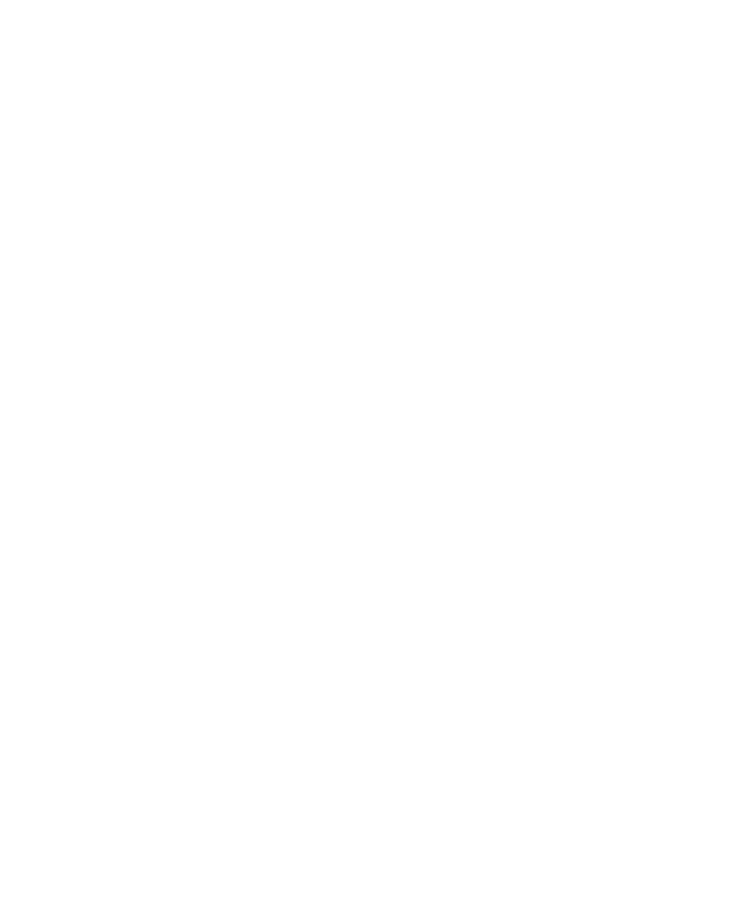

# FunshiEngineGL

<div align="center">
  
  <br/>
  <strong>Motor y editor de juegos en tiempo real</strong>
  <br/>
  Escrito en C++17 · Dear ImGui · OpenGL 3.3 Core
</div>

---

## Requisitos

### Sistema operativo
- **Linux** (probado en Ubuntu 22.04/24.04, Debian 12)
- **Windows** (via MSVC + vcpkg, ver CI)
- **macOS** (experimental, sin CI dedicado)

### Dependencias de sistema (Linux)
```bash
sudo apt-get update && sudo apt-get install -y \
  libglfw3-dev \
  libgl1-mesa-dev \
  libglu1-mesa-dev \
  libglm-dev \
  libncurses-dev \
  libassimp-dev \
  libbullet-dev \
  libasound2-dev \
  libxrandr-dev \
  libxi-dev \
  glslang-tools \
  cmake ninja-build
```

### Opcionales
- **JDK 17+** — requerido para `FUNSHI_JAVA=ON` (scripts Java vía JNI)
- **CEF** — requerido para `FUNSHI_WEBUI=ON` + `FUNSHI_CEF=ON` (interfaces web)

---

## Instalación y compilación

```bash
# 1. Clonar el repositorio
git clone https://github.com/FunshiEngine/FunshiEngineOpenGL.git
cd FunshiEngineOpenGL

# 2. Configurar (Release, ASAN off, Java on)
cmake -B build -S FunshiEngineGL -G Ninja \
  -DCMAKE_BUILD_TYPE=Release \
  -DENABLE_ASAN=OFF \
  -DFUNSHI_JAVA=ON

# 3. Compilar
cmake --build build -j$(nproc)
```

### Opciones CMake principales

| Opción | Default | Descripción |
|--------|---------|-------------|
| `BUILD_ENGINE` | `ON` | Compilar librería y ejecutable del motor |
| `FUNSHI_JAVA` | `ON` | Soporte scripts Java (requiere JDK) |
| `FUNSHI_WEBUI` | `ON` | Soporte interfaces web (backend CEF) |
| `FUNSHI_CEF` | `OFF` | Compilar backend CEF real (pesa ~200 MB) |
| `BUILD_RUNTIME` | `OFF` | Solo librería del motor (sin editor ni tests) |
| `USE_ASSIMP` | `ON` | Carga de modelos vía Assimp |
| `ENABLE_ASAN` | `OFF` | AddressSanitizer (solo Debug) |

---

## Ejecución

```bash
# Desde la raíz del repo
cd FunshiEngineGL && ./build/FunshiEngineGL
```

El editor abre con una escena vacía. Usa **Archivo → Nuevo** o arrastra assets a la vista de archivos.

---

## Pruebas

El proyecto incluye ~60 suites de tests (unitarias, integración, rendering headless, partículas, UI, audio, scripts, etc.).

```bash
# Ejecutar todas las pruebas
cd FunshiEngineGL/build && ctest --output-on-failure -j$(nproc)

# Ejecutar una suite concreta
./particulas-tests
./rendering-tests
./scripts-tests
```

En CI (GitHub Actions) se ejecutan en Ubuntu, Windows (MSVC) y multi-config (Debug/Release/RelWithDebInfo/MinSizeRel).

---

## Capturas del editor

<div align="center">
  
  <br/>
  <em>Editor FunshiEngineGL con escena cargada (imagen de referencia)</em>
</div>

---

## Documentación

- [doc/MANUAL_DE_USO.md](doc/MANUAL_DE_USO.md) – Guía de uso del editor y scripting
- [doc/PROJECT_STRUCTURE.md](doc/PROJECT_STRUCTURE.md) – Arquitectura y estructura del proyecto
- [doc/FLUJO_DE_RAMAS.md](doc/FLUJO_DE_RAMAS.md) – Convención de ramas
- [doc/DocuTecnicoBugs.md](doc/DocuTecnicoBugs.md) – Registro técnico de bugs

---

## Licencia

**Copyright 2026 Gianfranco Ivan Enrique**

El código propio del motor se distribuye bajo la **Apache License 2.0** (ver [LICENSE](LICENSE) y [NOTICE](NOTICE)).

Las bibliotecas de terceros integradas (Dear ImGui, ImGuizmo, nlohmann/json, stb_image, GLM) conservan sus licencias originales —principalmente MIT— y **no están cubiertas por la Apache License 2.0**. Consulta [THIRD_PARTY_NOTICES.md](THIRD_PARTY_NOTICES.md) para el detalle completo de licencias, titulares y ubicaciones.
