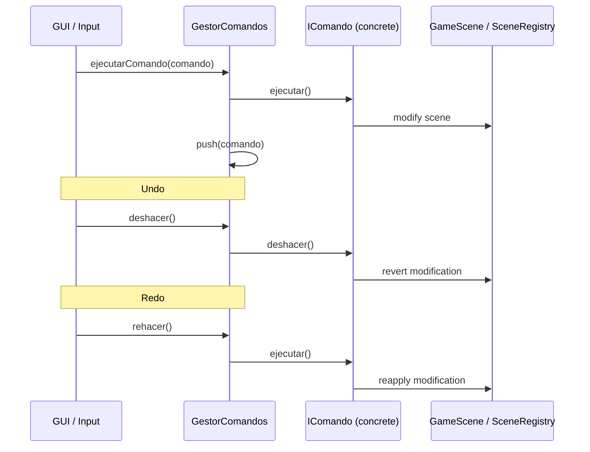

# Architecture UML - FunshiEngineOpenGL

UML architecture documentation of the FunshiEngineGL 3D graphics engine.
Generated from source code in `FunshiEngineGL/src/`.

Conventions:
- **Language**: English
- **Format**: Mermaid (diagrams directly in Markdown)
- **Relationships**: `..|>` implementation, `--` association, `*` composition, `-->` dependency

## 1. Layer and General Architecture Diagram

```mermaid
graph TD
    subgraph KX_API [Public C API - KX_API]
        direction TB
        kx_init[kx_init]
        kx_shutdown[kx_shutdown]
        kx_render_frame[kx_render_frame]
        kx_process_events[kx_process_events]
    end

    subgraph ESTADOS [GUI State Orchestrator]
        direction TB
        OSM[ApplicationStateMachine]
        OEG[OrquestadorEstadoGUI]
    end

    subgraph FACHADAS [C++ Subsystem Facades]
        direction TB
        GE[GameScene]
        GS[SceneRegistry]
        SS[SceneSerializer]
        AE[AudioEngine]
        PE[PhysicsEngine]
        AM[AssetManager]
        SR[SceneRenderer]
        GM[GUIManager]
        EC[EditorConfig]
        GC[GestorComandos]
    end

    subgraph DRIVERS [Drivers / Backends - Strategy Pattern]
        direction TB
        OGL3[OpenGL3Backend]
        MAB[MiniAudioBackend]
        NAB[NullAudioBackend]
        BP[BulletPhysicsAdapter]
        BC[BackendCpp]
        BJ[BackendJava]
    end

    subgraph NUCLEO [Core: Structures, Entities, Exceptions]
        direction TB
        GO[GameObject]
        CP[Component]
        TR[Transform]
        CC[CameraComponent]
        EN[Entity]
        TH[Throwable]
        RE[RuntimeException]
    end

    KX_API -->|dispatch| ESTADOS
    ESTADOS -->|controls| FACHADAS
    FACHADAS -->|uses| DRIVERS
    FACHADAS -->|uses| NUCLEO
    DRIVERS -->|implements| NUCLEO

    GE -->|owns| GS
    GE -->|owns| PE
    GE -->|owns| AM
    GE -->|owns| SR
    GE -->|uses| GM
    GE -->|uses| EC

    OGL3 ..|>|IRenderBackend
    MAB ..|>|IAudioBackend
    NAB ..|>|IAudioBackend
## 2. Component and Dependency Diagram

```mermaid
classDiagram
    class IRenderBackend {
        <<interface>>
        +init(): bool
        +createMesh(data: MeshData): Handle
        +drawMesh(mesh: Handle, firstIndex: uint, indexCount: uint)
        +createTexture2D(image: Image2D): Handle
        +useProgram(program: Handle)
        +setUniformMat4(location: int, value: mat4)
        +setViewport(x, y, width, height)
        +clearScreen(color: float[3])
    }
    class IAudioBackend {
        <<interface>>
        +iniciar(): bool
        +reproducirArchivo(ruta: string, volumen: float, bucle: bool, posicion: float*): int
        +detener(id: int)
        +setVolumenMaestro(volumen: float)
        +despachar(deltaTime: float)
    }
    class IPhysicsBackend {
        <<interface>>
        +stepSimulation(deltaTime: float)
        +addRigidBody(body: RigidBody*)
        +removeRigidBody(body: RigidBody*)
        +tomarEventosContacto(): vector~EventoContacto~
        +raycast(ox, oy, oz, dx, dy, dz, alcance: float): ResultadoRaycast
    }
    class IComando {
        <<interface>>
        +ejecutar()
        +deshacer()
        +descripcion(): string
    }
    class IScriptBehaviour {
        <<interface>>
        +onStart(owner: GameObject*)
        +onUpdate(owner: GameObject*, deltaTime: float)
        +onCollisionEnter(owner: GameObject*, propio: Collider*, otro: Collider*)
    }
    class BackendScript {
        <<abstract>>
        +lenguaje(): const char*
        +compilarYCargar(fuente: string, nombreClase: string, salida: ComportamientoCargado&, error: string&): bool
    }
    class IMeshLoader {
        <<interface>>
        +load(path: string): shared_ptr~Mesh~
    }

    class OpenGL3Backend {
        +init(): bool override
        +createMesh(data: MeshData): Handle override
        +drawMesh(mesh: Handle, firstIndex: uint, indexCount: uint) override
    }
    class MiniAudioBackend {
        +iniciar(): bool override
        +reproducirArchivo(ruta: string, volumen: float, bucle: bool, posicion: float*): int override
    }
    class NullAudioBackend {
        +iniciar(): bool override
        +reproducirArchivo(ruta: string, volumen: float, bucle: bool, posicion: float*): int override
    }
    class BackendCpp {
        +lenguaje(): const char* override
        +compilarYCargar(...): bool override
    }
    class BackendJava {
        +lenguaje(): const char* override
        +compilarYCargar(...): bool override
        +apagarJvm(): static
    }
    class AssimpMeshLoader {
        +load(path: string): shared_ptr~Mesh~ override
    }

    class GameScene {
        -backend_: Backend::IRenderBackend&
        -sceneRegistry: unique_ptr~SceneRegistry~
        -phisics: unique_ptr~PhysicsEngine~
        -assetManager: unique_ptr~AssetManager~
        -sceneRenderer: unique_ptr~SceneRenderer~
    }
    class PhysicsEngine {
        -backend_: unique_ptr~IPhysicsBackend~
    }
    class AudioEngine {
## 3. Sequence Diagrams

### 3.1 Per-Frame Rendering Sequence

```mermaid
sequenceDiagram
    participant main as main.cpp
    participant OSM as ApplicationStateMachine
    participant OEG as OrquestadorEstadoGUI
    participant GS as GameScene
    participant SR as SceneRenderer
    participant BE as IRenderBackend (OpenGL3Backend)
    participant GE as GestorShaders
    participant AM as AssetManager

    main->>OEG: menuDebeEstarVisible()
    OEG->>OSM: getState()
    OSM-->>OEG: ApplicationState
    OEG-->>main: bool

    alt Menu Open
        main->>GM: draw menu
    else Editor / Game
        main->>GS: actualizar(deltaTime)
        GS->>PE: stepSimulation(deltaTime)
        GS->>SR: renderizar(frameContext)
        SR->>BE: setViewport(x, y, w, h)
        SR->>BE: clearScreen(color)
        SR->>BE: setDepthFunc(Less)
        SR->>GE: obtener("malla")
        GE-->>SR: ShaderProgram
        SR->>BE: useProgram(program)
        SR->>AM: getMesh(path)
        AM-->>SR: Mesh
        SR->>BE: createMesh(data)
        SR->>BE: drawMesh(mesh, 0, count)
        SR->>BE: drawFullscreenTriangle()
    end
```

### 3.2 Command Undo/Redo Sequence



### 3.3 Script Load and Execution Sequence

```mermaid
sequenceDiagram
    participant SR as ScriptRuntime
    participant BC as BackendCpp / BackendJava
    participant GS as GameScene
    participant GO as GameObject
    participant SB as IScriptBehaviour

## 4. External Library Dependency Diagram

```mermaid
graph TD
    subgraph Motor [FunshiEngineGL]
        direction TB
        API[Public C API]
        Core[C++ Internal Layers]
    end

    subgraph Graphics [Graphics and Window]
        direction TB
        GL[OpenGL 3.3 core]
        GLFW[GLFW - window/input]
        ImGui[Dear ImGui - GUI]
        ImGuizmo[ImGuizmo - gizmos]
        GLM[GLM - mathematics]
        stb[stb_image - image loading]
        miniz[miniz - ZIP compression]
    end

    subgraph Physics [Physics]
        Bullet[Bullet Physics]
    end

    subgraph Audio [Audio]
        miniaudio[miniaudio]
    end

    subgraph Models [Model Loading]
        Assimp[Assimp - 3D import]
    end

    subgraph JSON [Serialization]
        nlohmann[nlohmann/json]
    end

    subgraph Web [Web UI - optional]
        CEF[Chromium Embedded Framework]
    end

    subgraph Scripting [Scripting]
        JVM[JVM / libjvm - optional FUNSHI_JAVA]
    end

    Motor -->|uses| Graphics
    Motor -->|uses| Physics
    Motor -->|uses| Audio
    Motor -->|uses| Models
    Motor -->|uses| JSON
    Motor -.->|optional| Web
    Motor -.->|optional| Scripting

    API -->|on| Core
    Core -->|driver| GL
    Core -->|window| GLFW
    Core -->|GUI| ImGui
    Core -->|gizmo| ImGuizmo
    Core -->|math| GLM
    Core -->|images| stb
    Core -->|ZIP| miniz
    Core -->|physics| Bullet
    Core -->|audio| miniaudio
    Core -->|models| Assimp
    Core -->|JSON config| nlohmann
```

## 5. Design Patterns Identified

| Pattern | Classes Involved | File |
|---------|-----------------|------|
| **Strategy** | `IRenderBackend` → `OpenGL3Backend`, `IAudioBackend` → `MiniAudioBackend`/`NullAudioBackend`, `IPhysicsBackend` → `BulletPhysicsAdapter`, `IMeshLoader` → `AssimpMeshLoader` | `src/Rendering/Backend/`, `src/Audio/`, `src/Fisicas/`, `src/Assets/` |
| **Facade** | `PhysicsEngine`, `AudioEngine`, `GameScene`, `GUIManager` | `src/Fisicas/`, `src/Audio/`, `src/Scenes/`, `src/GUIManager/` |
| **Command** | `IComando` → 10 concrete commands, `GestorComandos` | `src/Comandos/` |
| **Observer / EventBus** | `EventBus`, `EditorEventBus`, `SceneEvent` | `src/Events/` |
| **State** | `ApplicationStateMachine`, `OrquestadorEstadoGUI` | `src/States/` |
| **Flyweight** | `AssetManager` (shared mesh cache) | `src/Assets/` |
| **Factory** | `GameObjectFactory`, `ComponentFactory`, `CatalogoComponentes` | `src/Objetos/` |
| **Singleton / Global Access** | `activeBackend()` (IRenderBackend) | `src/Rendering/Backend/IRenderBackend.h` |
| **Pimpl** | `AudioEngine::Impl`, `OpenGL3Backend` (private GPU structs) | `src/Audio/AudioEngine.h`, `src/Rendering/Backend/OpenGL3Backend.h` |
| **Template Method** | `Component::serializeComponent/deserializeComponent` | `src/Objetos/Componentes/Component.h` |
| **Iterator** | `ListaDE<T>`, `Position<T>`, `ArbolEnlazado<T>` | `src/Estructuras/` |

## 6. Editor Initialization Flow

```mermaid
graph TD
    A[main.cpp] --> B[Ventana::crear()]
    B --> C[EngineTime::actualizar()]
    C --> D[EditorConfig::cargar()]
    D --> E[GUIManager::crear()]
    E --> F[GameScene::crear(backend)]
    F --> G[SceneRegistry::createDefaultRoot()]
    G --> H[OrquestadorEstadoGUI]
    H --> I[main loop: update + render]
    I --> J{state?}
    J -->|MainMenu| K[draw MenuGUI]
    J -->|Editing/Debugging/Playing| L[draw DockSpaceGUI + panels]
    L --> M[GameScene::actualizar(deltaTime)]
    M --> N[GameScene::renderizar()]
    N --> O[Ventana::intercambiarBuffers()]
    O --> I
```

---

Files generated:
- `doc/ArquitecturaUML.es.md` (Spanish version)
- `doc/ArquitecturaUML.eng.md` (this file, English)

Complies with skill `doc.md`: Mermaid diagrams in `doc/`, `.es.md` / `.eng.md` format, real code architecture.
    GS->>SR: compilarYCargar(fuente, clase, salida, error)
    SR->>BC: compilarYCargar(fuente, clase, salida, error)
    BC->>BC: compile .cpp/.java to .so/.class
    BC->>BC: dlopen / load JVM
    BC-->>SR: ComportamientoCargado
    SR-->>GS: ComportamientoCargado

    GS->>GO: addComponent(Script)
    GO->>SB: onStart(owner)
    GS->>SR: llamarActualizar(comportamiento, owner, dt)
    SR->>SB: onUpdate(owner, deltaTime)
    SB-->>SR: void
    SR-->>GS: void
```
        -impl_: unique_ptr~Impl~
    }
    class SceneRenderer {
        -backend: Backend::IRenderBackend&
        -meshRenderer: unique_ptr~MeshRenderer~
    }
    class AssetManager {
        -loader_: unique_ptr~IMeshLoader~
    }
    class GestorComandos {
        -comandos: vector~unique_ptr~IComando~~
    }
    class ScriptRuntime {
        <<static>>
        +compilarYCargar(fuente: string, nombreClase: string, salida: ComportamientoCargado&, error: string&): static bool
    }
    class GUIManager {
        -menuGUI: unique_ptr~MenuGUI~
        -eventosEditor: EditorEventBus
    }
    class EditorConfig {
        -datos_: Datos
    }
    class EventBus {
        +subscribe(callback: Callback): size_t
        +publish(event: SceneEvent)
    }
    class EditorEventBus {
        +subscribe(callback: Callback): size_t
        +publish(event: SceneEvent)
    }

    IRenderBackend <|.. OpenGL3Backend
    IAudioBackend <|.. MiniAudioBackend
    IAudioBackend <|.. NullAudioBackend
    IPhysicsBackend <|.. (BulletPhysicsAdapter)
    BackendScript <|-- BackendCpp
    BackendScript <|-- BackendJava
    IMeshLoader <|.. AssimpMeshLoader

    GameScene *-- PhysicsEngine : owns
    GameScene *-- AssetManager : owns
    GameScene *-- SceneRenderer : owns
    GameScene --> IRenderBackend : injects backend
    PhysicsEngine *-- IPhysicsBackend : owns
    AudioEngine *-- IAudioBackend : owns
    AssetManager --> IMeshLoader : injects (Strategy)
    GestorComandos *-- IComando : owns commands
    ScriptRuntime ..> BackendScript : dispatches
    GUIManager --> EditorEventBus : owns event bus
    GUIManager --> MenuGUI : owns menu
```
    BP ..|>|IPhysicsBackend
    BC ..|>|BackendScript
    BJ ..|>|BackendScript

    style KX_API fill:#f9f,stroke:#333,stroke-width:2px
    style FACHADAS fill:#bbf,stroke:#333,stroke-width:2px
    style DRIVERS fill:#bfb,stroke:#333,stroke-width:2px
    style NUCLEO fill:#fdd,stroke:#333,stroke-width:2px
    style ESTADOS fill:#ffd,stroke:#333,stroke-width:2px
```

Location: `src/`, `src/States/`, `src/Fisicas/`, `src/Audio/`, `src/Rendering/`, `src/Objetos/`, `src/ExcepcionesCPP/`