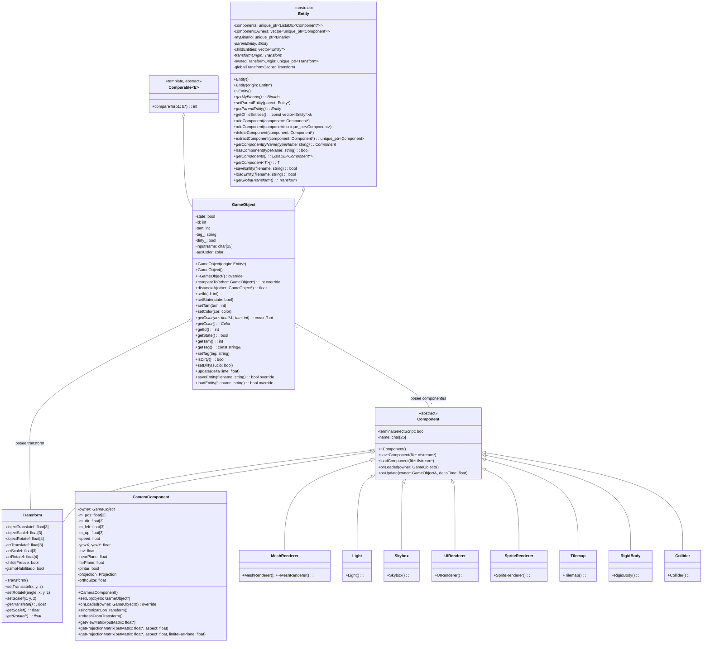

# Diagrama de Clases - FunshiEngineOpenGL

Diagrama UML de clases del motor gráfico 3D FunshiEngineGL. Generado a partir del código fuente en `FunshiEngineGL/src/`.

Convenciones:
- **Tipos**: PascalCase (`GameObject`, `RenderCommand`)
## 1. Jerarquía de Excepciones

```mermaid
classDiagram
    class std::exception {
        <<standard>>
        +what()
    }
    class std::runtime_error {
        <<standard>>
    }
    class Throwable {
        <<abstract>>
        -message: string
        -stackTrace: string
        +Throwable(msg = "")
        +what(): const char* override
        +getStackTrace(): const char*
        +~Throwable()
    }
    class RuntimeException {
        -stackTrace: vector~string~
        -tipoExcepcion: string
        +RuntimeException(msg, tipo = "RuntimeException")
        +getStackTrace(): string
        +getTipoExcepcion(): const string&
        +~RuntimeException()
    }
    class NullPointerException {
        +~NullPointerException()
    }
    class ClassCastException {
        +~ClassCastException()
    }
    class InvalidOperationException {
        +~InvalidOperationException()
    }
    class BoundaryViolationException {
        +~BoundaryViolationException()
    }

    std::exception <|-- std::runtime_error
    std::runtime_error <|-- Throwable
    Throwable <|-- RuntimeException
    RuntimeException <|-- NullPointerException
    RuntimeException <|-- ClassCastException
    RuntimeException <|-- InvalidOperationException
    RuntimeException <|-- BoundaryViolationException
```

Ubicación: `src/ExcepcionesCPP/`

## 2. Entidades, Componentes y Objetos de Escena


## 3. Rendering (Backend y Pipeline)

```mermaid
classDiagram
    class IRenderBackend {
        <<interface>>
        +~IRenderBackend()
        +init(): bool
        +available(): bool
        +createMesh(data: MeshData): Handle
        +destroyMesh(mesh: Handle)
        +drawMesh(mesh: Handle, firstIndex: uint, indexCount: uint)
        +createLineBatch(vertices: float*, count: size_t): Handle
        +destroyLineBatch(batch: Handle)
        +updateLineBatch(batch: Handle, vertices: float*, count: size_t)
        +drawLineBatch(batch: Handle, count: uint)
        +createTexture2D(image: Image2D): Handle
        +destroyTexture2D(texture: Handle)
        +bindTexture2D(texture: Handle, unit: int)
        +createTextureCube(image: ImageCube): Handle
        +destroyTextureCube(texture: Handle)
        +bindTextureCube(texture: Handle, unit: int)
    }
    class OpenGL3Backend {
        -meshes: unordered_map~Handle, GpuMesh~
        -lineBatches: unordered_map~Handle, GpuLineBatch~
        -particulasBatches: unordered_map~Handle, GpuParticulasBatch~
        -targets: unordered_map~Handle, GpuTarget~
        -depthTargets: unordered_map~Handle, GpuDepthTarget~
        -depthCuboTargets: unordered_map~Handle, GpuDepthCuboTarget~
        -tamanosTextura2D: unordered_map~Handle, pair~int, int~~
        -fboCargadas_: bool
        -modoBlend_: BlendMode
        -vaoPantallaCompleta_: unsigned int
        +OpenGL3Backend()
        +~OpenGL3Backend()
        +init(): bool override
        +available(): bool override
    }
    class MeshData {
        -vertices: const float*
        -vertexCount: size_t
        -normals: const float*
        -normalCount: size_t
        -uvs: const float*
        -uvCount: size_t
        -tangents: const float*
        -tangentCount: size_t
        -bitangents: const float*
        -bitangentCount: size_t
        -indices: const unsigned int*
        -indexCount: size_t
    }
    class Image2D {
        -width: int
        -height: int
        -pixels: const unsigned char*
        -generateMipmaps: bool
    }
    class ImageCube { }
    class SceneRenderer {
        -backend: Backend::IRenderBackend&
        -meshRenderer: unique_ptr~MeshRenderer~
        -grillaRenderer: GrillaRenderer
        -mapaSombras: MapaSombras
        -spriteRenderer: SpriteRenderer
        -tilemapRenderer: TilemapRenderer
        -particulasRenderer: ParticulasRenderer
        -cieloProgram: shared_ptr~ShaderProgram~
        -skyboxProgram: shared_ptr~ShaderProgram~
        -gestorShaders: GestorShaders*
        -skyboxCubemap: Handle
        -skyboxCuboMalla: Handle
        -skyboxClave: string
        -marcadoresBatch: LineBatch
        -viewportsCamaras: vector~unique_ptr~RenderTarget~~
        -viewportsObjetos: vector~GameObject*~
        +SceneRenderer(backend: Backend::IRenderBackend&)
        +~SceneRenderer()
        +render(frameContext: FrameContext&)
        +setTextureManager(textureManager: TextureManager*)
        +setResolvedorMateriales(resolvedor: IResolutorMateriales*)
        +setGestorShaders(gestorShaders: GestorShaders*)
    }
    class GrillaRenderer { +GrillaRenderer(); +render(ctx: FrameContext&); }
    class GuiaEje { +GuiaEje(); +render(ctx: FrameContext&); }
    class MapaSombras { +MapaSombras(); +render(ctx: FrameContext&); }
    class LineBatch { +LineBatch(); +draw(); }
    class RenderTarget { +RenderTarget(); +~RenderTarget(); }
    class TextureManager { +TextureManager(); +getTexture(path: string); }
    class IResolutorMateriales { <<interface>> +resolverMaterial(region: string): Material*; }
    class Material {
        -ambiente: float[3]
        -difusa: float[3]
        -especular: float[3]
        -emision: float[3]
        -brillo: float
        +Material()
    }

    SceneRenderer ..|> IRenderBackend : usa
    SceneRenderer *-- MeshRenderer : posee
    SceneRenderer *-- GrillaRenderer : posee
    SceneRenderer *-- GuiaEje : posee
    SceneRenderer *-- MapaSombras : posee
    SceneRenderer *-- SpriteRenderer : posee
    SceneRenderer *-- TilemapRenderer : posee
    SceneRenderer *-- ParticulasRenderer : posee
    SceneRenderer --> GestorShaders : usa
    SceneRenderer --> TextureManager : usa
## 4. Física y Audio

```mermaid
classDiagram
    class IPhysicsBackend {
        <<interface>>
        +~IPhysicsBackend()
        +stepSimulation(deltaTime: float)
        +addRigidBody(body: RigidBody*)
        +removeRigidBody(body: RigidBody*)
        +tomarEventosContacto(): vector~EventoContacto~
        +fijarGravedad(x: float, y: float, z: float)
        +gravedad(x: float&, y: float&, z: float)
        +raycast(ox, oy, oz, dx, dy, dz, alcance: float): ResultadoRaycast
    }
    class PhysicsEngine {
        -backend_: unique_ptr~IPhysicsBackend~
        +PhysicsEngine()
        +PhysicsEngine(backend: unique_ptr~IPhysicsBackend~)
        +~PhysicsEngine()
        +stepSimulation(deltaTime: float)
        +addRigidBody(body: RigidBody*)
        +removeRigidBody(body: RigidBody*)
        +tomarEventosContacto(): vector~EventoContacto~
        +fijarGravedad(x: float, y: float, z: float)
        +gravedad(x: float&, y: float&, z: float)
        +raycast(ox, oy, oz, dx, dy, dz, alcance: float): ResultadoRaycast
    }
    class RigidBody { +RigidBody(); +~RigidBody(); }
    class Collider { +Collider(); +~Collider(); }
    struct EventoContacto { }
    struct ResultadoRaycast {
        -impacto: bool
        -distancia: float
        -puntoX, puntoY, puntoZ: float
        -normalX, normalY, normalZ: float
        -collider: Collider*
    }

    IPhysicsBackend <|.. PhysicsEngine : usa (Strategy)
    PhysicsEngine *-- IPhysicsBackend : posee

    class IAudioBackend {
        <<interface>>
        +~IAudioBackend()
        +iniciar(): bool
        +cerrar()
        +reproducirArchivo(ruta: string, volumen: float, bucle: bool, posicion: float*): int
        +detener(id: int)
        +detenerTodo()
        +setVolumenMaestro(volumen: float)
        +setPosicionSonido(id: int, x: float, y: float, z: float)
        +setListenerPosition(x: float, y: float, z: float)
        +despachar(deltaTime: float)
        +backendMusica(): IMusicaBackend*
    }
    class MiniAudioBackend {
        +MiniAudioBackend()
        +~MiniAudioBackend()
        +iniciar(): bool override
        +cerrar() override
    }
    class NullAudioBackend {
        +NullAudioBackend()
        +~NullAudioBackend()
        +iniciar(): bool override
        +cerrar() override
    }
    class IMusicaBackend { <<interface>> +~IMusicaBackend(); }
    class AudioEngine {
## 5. Scripting y Comportamientos

```mermaid
classDiagram
    class IScriptBehaviour {
        <<interface>>
        -api: const ApiScriptGameObject*
        -servicios: const ScriptServices*
        +~IScriptBehaviour()
        +onStart(owner: GameObject*)
        +onUpdate(owner: GameObject*, deltaTime: float)
        +onCollisionEnter(owner: GameObject*, propio: Collider*, otro: Collider*)
        +onCollisionStay(owner: GameObject*, propio: Collider*, otro: Collider*)
        +onCollisionExit(owner: GameObject*, propio: Collider*, otro: Collider*)
        +conectarApi(tabla: const ApiScriptGameObject*)
        +onStop(owner: GameObject*)
        +camposReflejados(): vector~DefCampo~
    }
    class BackendScript {
        <<abstract>>
        +~BackendScript()
        +lenguaje(): const char*
        +compilarYCargar(fuente: string, nombreClase: string, salida: ComportamientoCargado&, error: string&): bool
        +descargar(comportamiento: ComportamientoCargado&)
        +descargar(comportamiento: ComportamientoCargado&, owner: GameObject*)
        +llamarInicio(comportamiento: ComportamientoCargado&, owner: GameObject*)
        +llamarActualizar(comportamiento: ComportamientoCargado&, owner: GameObject*, deltaTime: float)
        +llamarDetener(comportamiento: ComportamientoCargado&, owner: GameObject*)
        +llamarContacto(comportamiento: ComportamientoCargado&, owner: GameObject*, propio: Collider*, otro: Collider*, tipo: TipoContacto)
    }
    class BackendCpp {
        +BackendCpp()
        +~BackendCpp()
        +lenguaje(): const char* override
    }
    class BackendJava {
        +BackendJava()
        +~BackendJava()
        +lenguaje(): const char* override
        +inyectar(comportamiento: ComportamientoCargado&, valores: vector~ValorCampo~): void override
        +extraer(comportamiento: ComportamientoCargado&): vector~ValorCampo~ override
        +apagarJvm(): static
    }
    class ScriptRuntime {
        <<static>>
        +lenguajeDeFuente(fuente: string): static const char*
        +backendPara(lenguaje: string): static BackendScript*
        +compilarYCargar(fuente: string, nombreClase: string, salida: ComportamientoCargado&, error: string&): static bool
        +descargar(c: ComportamientoCargado&): static void
        +llamarInicio(c: ComportamientoCargado&, owner: GameObject*): static void
## 6. Comandos (Undo/Redo)

```mermaid
classDiagram
    class IComando {
        <<interface>>
        +~IComando()
        +ejecutar()
        +deshacer()
        +descripcion(): string
    }
    class GestorComandos {
        -comandos: vector~unique_ptr~IComando~~
        -indiceActual: int
        +GestorComandos()
        +~GestorComandos()
        +ejecutarComando(comando: unique_ptr~IComando~)
        +deshacer()
        +rehacer()
        +puedeDeshacer(): bool
        +puedeRehacer(): bool
    }
    class AgregarComponenteComando { +ejecutar() override +deshacer() override +descripcion(): string override }
    class QuitarComponenteComando { +ejecutar() override +deshacer() override +descripcion(): string override }
    class CrearObjetoComando { +ejecutar() override +deshacer() override +descripcion(): string override }
    class BorrarObjetoComando { +ejecutar() override +deshacer() override +descripcion(): string override }
    class ReparentarComando { +ejecutar() override +deshacer() override +descripcion(): string override }
    class TransformComando { +ejecutar() override +deshacer() override +descripcion(): string override }
    class EstablecerTagComando { +ejecutar() override +deshacer() override +descripcion(): string override }
    class DuplicarObjetoComando { +ejecutar() override +deshacer() override +descripcion(): string override }
    class LimpiarEscenaComando { +ejecutar() override +deshacer() override +descripcion(): string override }
    class AjustarVariableComando { +ejecutar() override +deshacer() override +descripcion(): string override }

    IComando <|.. GestorComandos : usa
    IComando <|-- AgregarComponenteComando
    IComando <|-- QuitarComponenteComando
    IComando <|-- CrearObjetoComando
    IComando <|-- BorrarObjetoComando
    IComando <|-- ReparentarComando
    IComando <|-- TransformComando
    IComando <|-- EstablecerTagComando
    IComando <|-- DuplicarObjetoComando
    IComando <|-- LimpiarEscenaComando
    IComando <|-- AjustarVariableComando

Ubicación: `src/Comandos/`
        +llamarActualizar(c: ComportamientoCargado&, owner: GameObject*, deltaTime: float): static void
        +llamarDetener(c: ComportamientoCargado&, owner: GameObject*): static void
        +llamarContacto(c: ComportamientoCargado&, owner: GameObject*, propio: Collider*, otro: Collider*, tipo: TipoContacto): static void
        +inyectar(c: ComportamientoCargado&, valores: vector~ValorCampo~): static void
## 7. Escena, Serialización y Registro

```mermaid
classDiagram
    class SceneRegistry {
        -ownedGameObjects: vector~unique_ptr~GameObject~~
        -entitys: ArbolEnlazado~GameObject*~
        -gameObjects: ListaDE~GameObject*~
        -viewDirty: bool
        +SceneRegistry()
        +~SceneRegistry()
        +getEntitysTree(): ArbolEnlazado~GameObject*~*
        +getGameObjects(): ListaDE~GameObject*~*
        +refreshGameObjectView()
        +getRoot(): GameObject*
        +contains(object: GameObject*): bool
        +createObject(object: unique_ptr~GameObject~, parent: GameObject*): GameObject*
        +siguienteIdDisponible(): int
        +replaceRoot(root: unique_ptr~GameObject~): bool
        +deleteObject(object: GameObject*): bool
        +deleteObjectByID(id: int): bool
        +reparent(object: GameObject*, parent: GameObject*): bool
        +clear()
        +getObjectByID(id: int): GameObject*
        +takeObject(object: GameObject*): unique_ptr~GameObject~
        +takeSubtree(object: GameObject*): vector~unique_ptr~GameObject~~
        +takeAllNonRoot(): vector~unique_ptr~GameObject~~
        +restoreSubtree(objects: vector~unique_ptr~GameObject~~, parent: GameObject*): GameObject*
    }
    class GameScene {
        -managerGUI: GUIManager*
        -backend_: Backend::IRenderBackend&
        -sceneRegistry: unique_ptr~SceneRegistry~
        -phisics: unique_ptr~PhysicsEngine~
        -assetManager: unique_ptr~AssetManager~
        -gestorShaders: unique_ptr~GestorShaders~
        -sceneRenderer: unique_ptr~SceneRenderer~
        -sistemaParticulas: SistemaParticulas
        -editorController: unique_ptr~EditorController~
        +GameScene(backend: Backend::IRenderBackend&)
        +~GameScene()
        +iniciar()
        +actualizar(deltaTime: float)
        +renderizar()
        +setActiveCamera(object: GameObject*)
        +getSistemaParticulas(): SistemaParticulas&
        +getEditorController(): EditorController*
        +getApariencia(): const Apariencia&
    }

    class SceneSerializer {
        -scene: SceneRegistry*
        -editor: EditorController*
        -assets: AssetManager*
        -diagnosticos: RegistroDiagnosticos*
        +SceneSerializer(scene, controller, assetsManager, registro)
        +save(filename: string)
        +load(pathTxt: string, semiPath: string): bool
    }
    class AssetManager {
        -meshes: unordered_map~string, shared_ptr~Mesh~~
        -fallos: unordered_map~string, string~
        -loader_: unique_ptr~IMeshLoader~
        +AssetManager(loader: unique_ptr~IMeshLoader~)
        +~AssetManager()
        +getMesh(path: string): shared_ptr~const Mesh~
        +putMesh(path: string, mesh: shared_ptr~Mesh~)
        +containsMesh(path: string): bool
        +meshCount(): size_t
        +removeMesh(path: string)
        +clearUnusedMeshes()
        +clearFailedMeshes()
        +hasFailedMesh(path: string): bool
        +failedMeshCount(): size_t
        +reloadMesh(path: string)
        +setLoader(loader: unique_ptr~IMeshLoader~)
    }
    class IMeshLoader { <<interface>> +~IMeshLoader() +load(path: string): shared_ptr~Mesh~ }
    class AssimpMeshLoader {
        +AssimpMeshLoader()
        +~AssimpMeshLoader()
        +load(path: string): shared_ptr~Mesh~ override
    }
    class EditorController { +EditorController() +~EditorController(); }
    class RegistroDiagnosticos { +RegistroDiagnosticos() +~RegistroDiagnosticos(); }
    class SistemaParticulas {
        +SistemaParticulas()
        +~SistemaParticulas()
        +actualizar(deltaTime: float)
        +emitir(emisor: EmisorConfig)
    }

    SceneSerializer --> SceneRegistry : usa
    SceneSerializer --> EditorController : usa
    SceneSerializer --> AssetManager : usa
    SceneSerializer --> RegistroDiagnosticos : usa
    AssetManager --> IMeshLoader : inyecta (Strategy)
    AssimpMeshLoader ..|> IMeshLoader : implementa

Ubicación: `src/Scenes/`, `src/Assets/`
## 8. GUI y Estados de la Aplicación

```mermaid
classDiagram
    class ApplicationStateMachine {
        -state: ApplicationState
        +getState(): ApplicationState
        +is(value: ApplicationState): bool
        +transitionTo(value: ApplicationState)
    }
    enum ApplicationState {
        MainMenu
        Editing
        Debugging
        Playing
        Exiting
    }
    class OrquestadorEstadoGUI {
        -maquina: ApplicationStateMachine*
        -solicitudCierrePendiente: bool
        -simulacionPausada_: bool
        -solicitudReset_: bool
        +OrquestadorEstadoGUI(maquina: ApplicationStateMachine*)
        +manejarTeclaEscape()
        +iniciarEstudio(): bool
        +manejarTeclaSimulacion(tecla: TeclaSimulacion)
        +alternarSimulacion()
        +iniciarJuego()
        +solicitarReset()
        +consumirSolicitudReset(): bool
        +menuDebeEstarVisible(): bool
        +escenaDebeCorrer(): bool
        +cerrarMenuPendiente(): bool
        +enSimulacion(): bool
        +enDepuracion(): bool
        +enModoJuego(): bool
        +simulacionPausada(): bool
        +dentroDelEditor(): bool
        +getEstado(): ApplicationState
    }
    class GUIManager {
        -fileManager: unique_ptr~FileManager~
        -menuGUI: unique_ptr~MenuGUI~
        -modeloSettings: unique_ptr~GameObject~
        -settingGUI: unique_ptr~SettingsObjectInterface~
        -selecteableGUI: unique_ptr~SceneSelectedInterface~
        -menuBarGUI: unique_ptr~SceneMenuBarInterface~
        -treeFilesGUI: unique_ptr~TreeFilesInterface~
        -dockSpaceGUI: unique_ptr~DockSpaceInterface~
        -iconosGUI: unique_ptr~IconosGUI~
        -reglaIconos: unique_ptr~ReglaIconoCatalogo~
        -resolutorIconos: unique_ptr~CatalogoIconos~
        -editor: EditorController*
        -contentOfThisFolder: unique_ptr~ContentFolderInterface~
        -statusBarGUI: unique_ptr~StatusBarInterface~
        -terminalGUI: unique_ptr~TerminalInterface~
        -panelesModsGUI: unique_ptr~PanelesModsInterface~
        -animacionesParticulasGUI: unique_ptr~AnimacionesParticulasInterface~
        -eventosEditor: EditorEventBus
        -ventanas_: vector~GeneralUserInterface*~
    class EditorEventBus {
        -listeners: unordered_map~size_t, Callback~
        -nextToken: size_t
        +subscribe(callback: Callback): size_t
        +unsubscribe(token: size_t)
        +publish(event: SceneEvent)
    }
    enum SceneEventType {
        ObjectCreated
        ObjectDeleted
        ObjectReparented
        ComponentChanged
        SceneCleared
        ObjectSelected
        ComponentStructureChanged
    }
    struct SceneEvent {
        -type: SceneEventType
        -object: GameObject*
        -relatedObject: GameObject*
    }
    class EditorConfig {
        -datos_: Datos
        -generalPendiente: bool
        -rutaGeneralPendiente: string
        -ultimaEscrituraGeneral: time_point
        +EditorConfig()
        +~EditorConfig()
        +cargar(ruta: string)
        +guardar(ruta: string)
        +guardarGeneral(ruta: string)
        +cargarGeneral(ruta: string)
        +guardarProyecto(nombreProyecto: string, ruta: string)
        +cargarProyecto(nombreProyecto: string, ruta: string)
        +solicitarGuardadoGeneral(ruta: string)
        +volcarGuardadoGeneral()
        +restablecer()
        +datos(): Datos&
    }
    struct Datos {
## 9. Ventana, Tiempo y Entrada

```mermaid
classDiagram
    class Ventana {
        +Ventana()
        +~Ventana()
        +crear(ancho: int, alto: int, titulo: string)
        +debeCerrarse(): bool
        +procesarEventos()
        +intercambiarBuffers()
        +obtenerContexto(): GLFWwindow*
    }
    class EngineTime {
        <<static>>
        +deltaTime(): float
        +tiempoTotal(): float
        +actualizar()
    }
    class EditorInput {
        +EditorInput()
        +~EditorInput()
        +procesarInput(window: GLFWwindow*)
        +descartarDeltaLook()
        +aplicarModoCursor(window: GLFWwindow*)
    }
    class TerminalEmulator { +TerminalEmulator() +~TerminalEmulator(); }
    class TerminalSession { +TerminalSession() +~TerminalSession(); }

    Ventana --> EngineTime : usa
    Ventana --> EditorInput : usa

Ubicación: `src/`, `src/Terminal/`, `src/Input/`

## 10. Exportador y Proyectos

```mermaid
classDiagram
    class GameExporter {
        +GameExporter()
        +~GameExporter()
        +exportarJuego(config: ConfigJuegoExportado)
    }
    class ConfigJuegoExportado {
        -nombreEjecutable: string
        -nombreProyectoExportado: string
        -plataformaObjetivo: string
    }
    class GestorDeProyectos {
        +GestorDeProyectos()
        +~GestorDeProyectos()
        +crearProyecto(nombre: string)
        +eliminarProyecto(nombre: string)
        +listarProyectos(): vector~string~
    }
    class EstadoExportacion { +EstadoExportacion() +~EstadoExportacion(); }

    GameExporter --> ConfigJuegoExportado : usa
    GestorDeProyectos --> ConfigJuegoExportado : usa

Ubicación: `src/Exportador/`, `src/Proyectos/`

## 11. Estructuras de Datos

```mermaid
classDiagram
    class ListaDE~T~ {
        <<template>>
        -cabeza: DNodo~T~*
        -cola: DNodo~T~*
        -tamano: int
        +ListaDE()
        +~ListaDE()
        +isEmpty(): bool
        +first(): Position~T~*
        +last(): Position~T~*
        +next(pos: Position~T~*): Position~T~*
        +getElement(): T
    }
    class ArbolEnlazado~T~ {
        <<template>>
        +ArbolEnlazado()
        +~ArbolEnlazado()
    }
    class DNodo~T~ {
        <<template>>
        -elemento: T
        -anterior: DNodo~T~*
        -siguiente: DNodo~T~*
    }
    class PriorityListaDE~T~ {
        <<template>>
        +PriorityListaDE()
        +~PriorityListaDE()
    }
    class Heap~T~ {
        <<template>>
        +Heap()
        +~Heap()
    }
    class MaxHeap~T~ { +MaxHeap() +~MaxHeap(); }
    class MinHeap~T~ { +MinHeap() +~MinHeap(); }
    class ArbolBinarioEnlazado~T~ {
        <<template>>
        +ArbolBinarioEnlazado()
        +~ArbolBinarioEnlazado()
    }

    DNodo~T~ <|.. ListaDE~T~ : usa
    MaxHeap~T~ ..|> Heap~T~
    MinHeap~T~ ..|> Heap~T~

Ubicación: `src/Estructuras/`

## Leyenda de Relaciones

| Símbolo | Significado |
|---------|-------------|
| `<|--` | Herencia generalización |
| `..|>` | Implementación de interfaz |
| `*` | Composición (propiedad fuerte, ciclo de vida compartido) |
| `o--` | Agregación (propiedad débil) |
| `--` | Asociación simple |
| `-->` | Dependencia / uso |

---

Archivos generados:
- `doc/DiagramaClases.es.md` (este archivo, español)
- `doc/DiagramaClases.eng.md` (versión en inglés)

Cumple con la skill `doc.md`: diagramas Mermaid en `doc/`, formato `.es.md` / `.eng.md`, arquitectura real del código.
        -version: int
        -nombreProyecto: string
        -idioma: string
        -sensibilidadCamara: float
        -sensibilidadMovimientoCamara: float
        -volumenMaestro: float
        -ventanaCamarasAbierta: bool
        -gizmoOperacion: int
        -gizmoGlobal: bool
        -camaraActivaId: int
        -dimension: DimensionProyecto
        -estadoVentanas: map~string, bool~
        -modsMotor: map~string, bool~
        -modsProyecto: map~string, bool~
    }
        +GUIManager(window: GLFWwindow*)
        +~GUIManager()
        +bindScene(scene, editor, events, dimensionProvider)
        +getEditorEventBus(): EditorEventBus*
        +getMenuGUI(): MenuGUI*
        +getSettingGUI(gameObject: GameObject*): SettingsObjectInterface*
        +getMenuBarGUI(): SceneMenuBarInterface*
        +getSelecteableGUI(): SceneSelectedInterface*
        +getDockSpaceGUI(): DockSpaceInterface*
        +registrarVentana(ventana: GeneralUserInterface*)
        +restaurarEstadosVentanas(estados: map~string, bool~)
        +obtenerEstadosVentanas(): map~string, bool~
        +setEstadoVentana(nombre: string, abierta: bool)
    }
    class MenuGUI { +MenuGUI() +~MenuGUI() +SetMenuActivo(activo: bool) +ConsultarMenu(): bool +actualizarProyectos() }
    class DockSpaceInterface { +DockSpaceInterface() +~DockSpaceInterface(); }
    class SceneSelectedInterface { +SceneSelectedInterface() +~SceneSelectedInterface(); }
    class SceneMenuBarInterface { +SceneMenuBarInterface() +~SceneMenuBarInterface(); }

    OrquestadorEstadoGUI --> ApplicationStateMachine : usa
    GUIManager --> EditorEventBus : posee
    GUIManager --> MenuGUI : posee
    GUIManager --> DockSpaceInterface : posee
    GUIManager --> SceneSelectedInterface : posee
    GUIManager --> SceneMenuBarInterface : posee
    GUIManager --> GeneralUserInterface : registra ventanas

Ubicación: `src/States/`, `src/GUIManager/`, `src/Configuracion/`
    SceneRegistry *-- GameObject : posee
    GameScene *-- SceneRegistry : posee
    GameScene *-- PhysicsEngine : posee
    GameScene *-- AssetManager : posee
    GameScene *-- SceneRenderer : posee
    GameScene --> GUIManager : usa
    GameScene --> EditorController : usa

Ubicación: `src/Scenes/`
        +extraer(c: ComportamientoCargado&): static vector~ValorCampo~
        +cambioElFuente(c: ComportamientoCargado&): static bool
        +apagarScripts(): static void
    }
    class ComportamientoCargado { }
    class ScriptGameObject { }
    class BehaviourReflection { }

    IScriptBehaviour <|.. BackendScript : usa
    BackendScript <|-- BackendCpp
    BackendScript <|-- BackendJava
    ScriptRuntime ..> BackendScript : despacha
    ScriptRuntime --> ComportamientoCargado : gestiona

Ubicación: `src/Behaviour/`
        -impl_: unique_ptr~Impl~
        +AudioEngine(backend: unique_ptr~IAudioBackend~)
        +AudioEngine()
        +~AudioEngine()
        +reproducir(ruta: string, volumen: float, bucle: bool, posicion: float*): int
        +detener(handle: int)
        +detenerTodo()
        +setVolumenMaestro(volumen: float)
        +setPosicionSonido(handle: int, x: float, y: float, z: float)
        +setListenerPosition(x: float, y: float, z: float)
        +establecerMusicas(rutas: vector~string~, repetir: bool)
        +musicas(): vector~string~
        +reproducirMusica(ruta: string, volumen: float, duracionFundido: float): bool
        +detenerMusica(duracionFundido: float)
        +setVolumenMusica(volumen: float)
        +silenciarMusica(silenciado: bool)
        +actualizarMusica(deltaTime: float)
        +esperarPilaVacia()
        +pendientes(): size_t
    }

    IAudioBackend <|.. MiniAudioBackend
    IAudioBackend <|.. NullAudioBackend
    AudioEngine *-- IAudioBackend : posee (Strategy)

Ubicación: `src/Fisicas/`, `src/Audio/`

Ubicación: `src/Rendering/`
    enum DepthFunc { Less LessEqual }
    enum BlendMode { Alpha Additive }
    class GestorShaders {
        -backend: Backend::IRenderBackend&
        -fragmentos: PreprocesadorShaders::Fragmentos
        -fuentes: unordered_map~string, pair~string, string~~
        -programas: unordered_map~string, shared_ptr~ShaderProgram~~
        +GestorShaders(backend: Backend::IRenderBackend&)
        +registrarFragmento(nombre: string, fuente: string)
        +registrarShader(nombre: string, vertex: string, fragment: string)
        +obtener(nombre: string): shared_ptr~ShaderProgram~
        +tiene(nombre: string): bool
        +invalidar()
        +cantidadProgramas(): size_t
    }
    class ShaderProgram {
        -programHandle: Handle
        -uniformLocations: unordered_map~string, int~
        +~ShaderProgram()
        +use()
        +setUniformMat4(name: string, value: mat4)
        +setUniformMat3(name: string, value: mat3)
        +setUniformVec3(name: string, value: vec3)
        +setUniformFloat(name: string, value: float)
        +setUniformInt(name: string, value: int)
    }

    IRenderBackend <|.. OpenGL3Backend
    GestorShaders --> IRenderBackend : usa
    ShaderProgram --> IRenderBackend : usa
```

Ubicación: `src/Rendering/`

Ubicación: `src/Objetos/`, `src/Objetos/Componentes/`

- **Métodos**: camelCase (`iniciarMotor`, `procesarComandos`)
- **Idioma**: español (identificadores, comentarios, documentación)
- **Relaciones**: `..|>` herencia / implementación, `--` asociación, `*` composición, `o--` agregación
