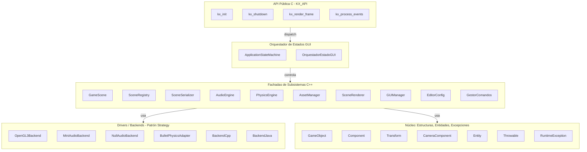
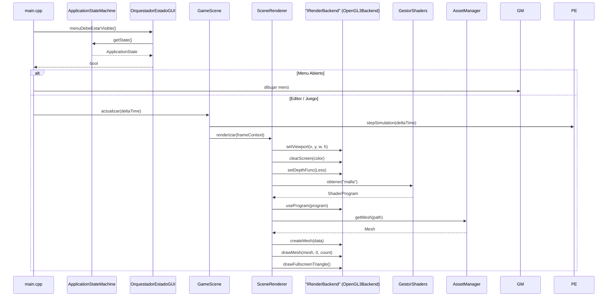
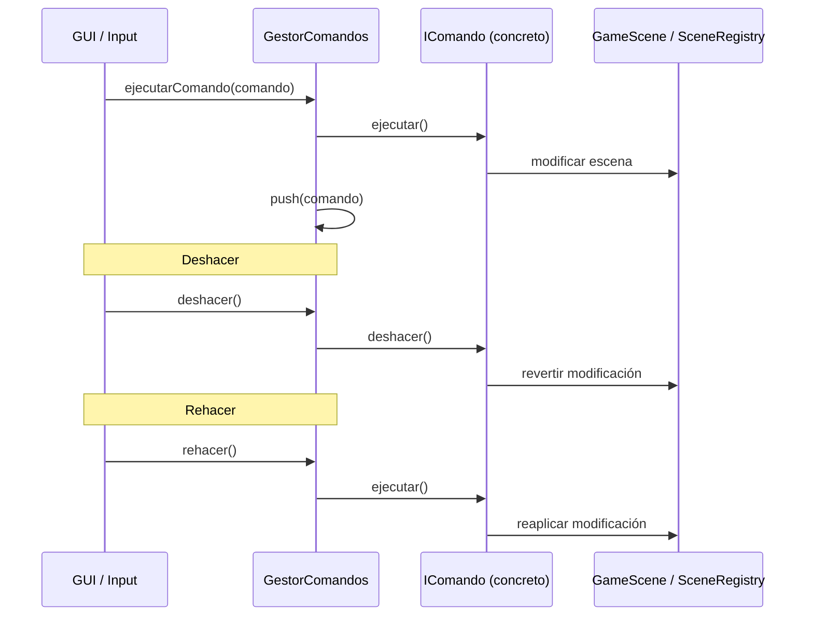
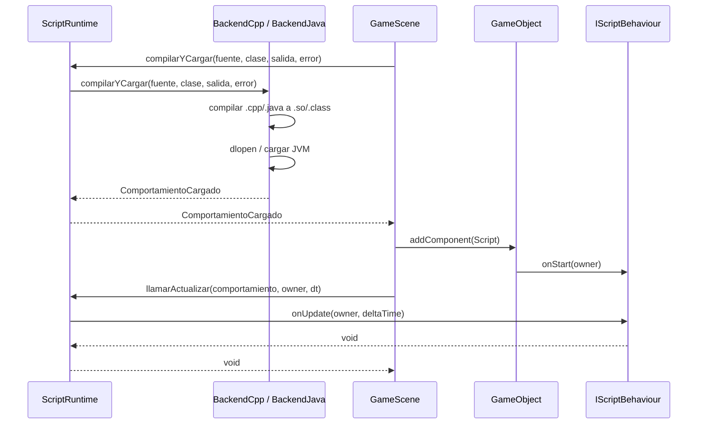

# Arquitectura UML - FunshiEngineOpenGL

Documentación de arquitectura en formato UML del motor gráfico 3D FunshiEngineGL.

Convenciones:
- **Idioma**: español (idioma principal del repositorio)
- **Formato**: Mermaid (diagramas directamente en Markdown)
- **Relaciones**: `..|>` implementación, `--` asociación, `*` composición, `-->` dependencia

> Note: nombres con caracteres especiales (`::`, `~`, `<`, `>`, `*`) van entre comillas para Mermaid.

## 1. Diagrama de Capas y Arquitectura General



## 2. Diagrama de Componentes y Dependencias

```mermaid
classDiagram
    class "IRenderBackend" {
        <<interface>>
        +~IRenderBackend()
        +init(): bool
        +createMesh(data: MeshData): Handle
        +drawMesh(mesh: Handle, firstIndex: uint, indexCount: uint)
        +createTexture2D(image: Image2D): Handle
        +useProgram(program: Handle)
        +setUniformMat4(location: int, value: mat4)
        +setViewport(x, y, width, height)
        +clearScreen(color: float[3])
    }
    class "IAudioBackend" {
        <<interface>>
        +iniciar(): bool
        +reproducirArchivo(ruta: string, volumen: float, bucle: bool, posicion: float*): int
        +detener(id: int)
        +setVolumenMaestro(volumen: float)
        +despachar(deltaTime: float)
    }
    class "IPhysicsBackend" {
        <<interface>>
        +stepSimulation(deltaTime: float)
        +addRigidBody(body: RigidBody*)
        +removeRigidBody(body: RigidBody*)
        +tomarEventosContacto(): vector<EventoContacto>
        +raycast(ox, oy, oz, dx, dy, dz, alcance: float): ResultadoRaycast
    }
    class IComando {
        <<interface>>
        +ejecutar()
        +deshacer()
        +descripcion(): string
    }
    class IScriptBehaviour {
        <<interface>>
        +onStart(owner: GameObject*)
        +onUpdate(owner: GameObject*, deltaTime: float)
        +onCollisionEnter(owner: GameObject*, propio: Collider*, otro: Collider*)
    }
    class BackendScript {
        <<abstract>>
        +lenguaje(): const char*
        +compilarYCargar(fuente: string, nombreClase: string, salida: ComportamientoCargado&, error: string&): bool
    }
    class IMeshLoader {
        <<interface>>
        +load(path: string): shared_ptr<Mesh>
    }

    class OpenGL3Backend {
        +init(): bool override
        +createMesh(data: MeshData): Handle override
        +drawMesh(mesh: Handle, firstIndex: uint, indexCount: uint) override
    }
    class MiniAudioBackend {
        +iniciar(): bool override
        +reproducirArchivo(ruta: string, volumen: float, bucle: bool, posicion: float*): int override
    }
    class NullAudioBackend {
        +iniciar(): bool override
        +reproducirArchivo(ruta: string, volumen: float, bucle: bool, posicion: float*): int override
    }
    class BackendCpp {
        +lenguaje(): const char* override
        +compilarYCargar(...): bool override
    }
    class BackendJava {
        +lenguaje(): const char* override
        +compilarYCargar(...): bool override
        +apagarJvm(): static
    }
    class AssimpMeshLoader {
        +load(path: string): shared_ptr<Mesh> override
    }

    class GameScene {
        -backend_: "IRenderBackend"
        -sceneRegistry: unique_ptr<SceneRegistry>
        -phisics: unique_ptr<PhysicsEngine>
        -assetManager: unique_ptr<AssetManager>
        -sceneRenderer: unique_ptr<SceneRenderer>
    }
    class PhysicsEngine {
        -backend_: unique_ptr<"IPhysicsBackend">
    }
    class AudioEngine {
        -impl_: unique_ptr<Impl>
    }
    class SceneRenderer {
        -backend: "IRenderBackend"
        -meshRenderer: unique_ptr<MeshRenderer>
    }
    class AssetManager {
        -loader_: unique_ptr<IMeshLoader>
    }
    class GestorComandos {
        -comandos: vector<unique_ptr<IComando>>
    }
    class ScriptRuntime {
        <<static>>
        +compilarYCargar(fuente: string, nombreClase: string, salida: ComportamientoCargado&, error: string&): static bool
    }
    class GUIManager {
        -menuGUI: unique_ptr<MenuGUI>
        -eventosEditor: EditorEventBus
    }
    class EditorConfig {
        -datos_: Datos
    }
    class EventBus {
        +subscribe(callback: Callback): size_t
        +publish(event: SceneEvent)
    }
    class EditorEventBus {
        +subscribe(callback: Callback): size_t
        +publish(event: SceneEvent)
    }

    "IRenderBackend" <|.. OpenGL3Backend
    "IAudioBackend" <|.. MiniAudioBackend
    "IAudioBackend" <|.. NullAudioBackend
    "IPhysicsBackend" <|.. (BulletPhysicsAdapter)
    BackendScript <|-- BackendCpp
    BackendScript <|-- BackendJava
    IMeshLoader <|.. AssimpMeshLoader

    GameScene *-- PhysicsEngine : posee
    GameScene *-- AssetManager : posee
    GameScene *-- SceneRenderer : posee
    GameScene --> "IRenderBackend" : inyecta backend
    PhysicsEngine *-- "IPhysicsBackend" : posee
    AudioEngine *-- "IAudioBackend" : posee
    AssetManager --> IMeshLoader : inyecta (Strategy)
    GestorComandos *-- IComando : posee comandos
    ScriptRuntime ..> BackendScript : despacha
    GUIManager --> EditorEventBus : posee bus de eventos
    GUIManager --> MenuGUI : posee menú
```

## 3. Diagramas de Secuencia

### 3.1 Secuencia de Renderizado por Frame



### 3.2 Secuencia de Comando Undo/Redo



### 3.3 Secuencia de Carga y Ejecución de Script



## 4. Diagrama de Dependencias de Librerías Externas

```mermaid
graph TD
    subgraph Motor [FunshiEngineGL]
        direction TB
        API[API Pública C]
        Core[Capas C++ Internas]
    end

    subgraph Gráficos [Gráficos y Ventana]
        direction TB
        GL[OpenGL 3.3 core]
        GLFW[GLFW - ventana/input]
        ImGui[Dear ImGui - GUI]
        ImGuizmo[ImGuizmo - gizmos]
        GLM[GLM - matemáticas]
        stb[stb_image - carga de imágenes]
        miniz[miniz - compresión ZIP]
    end

    subgraph Física [Física]
        Bullet[Bullet Physics]
    end

    subgraph Audio [Audio]
        miniaudio[miniaudio]
    end

    subgraph Modelos [Carga de Modelos]
        Assimp[Assimp - importación 3D]
    end

    subgraph JSON [Serialización]
        nlohmann[nlohmann/json]
    end

    subgraph Web [Web UI - opcional]
        CEF[Chromium Embedded Framework]
    end

    subgraph Scripting [Scripting]
        JVM[JVM / libjvm - opcional FUNSHI_JAVA]
    end

    Motor -->|usa| Gráficos
    Motor -->|usa| Física
    Motor -->|usa| Audio
    Motor -->|usa| Modelos
    Motor -->|usa| JSON
    Motor -.->|opcional| Web
    Motor -.->|opcional| Scripting

    API -->|sobre| Core
    Core -->|driver| GL
    Core -->|ventana| GLFW
    Core -->|GUI| ImGui
    Core -->|gizmo| ImGuizmo
    Core -->|matemáticas| GLM
    Core -->|imágenes| stb
    Core -->|ZIP| miniz
    Core -->|física| Bullet
    Core -->|audio| miniaudio
    Core -->|modelos| Assimp
    Core -->|config JSON| nlohmann
```



## 5. Patrones de Diseño Identificados

| Patrón | Clases Involucradas | Archivo |
|--------|---------------------|---------|
| **Strategy** | `IRenderBackend` → `OpenGL3Backend`, `IAudioBackend` → `MiniAudioBackend`/`NullAudioBackend`, `IPhysicsBackend` → `BulletPhysicsAdapter`, `IMeshLoader` → `AssimpMeshLoader` | `src/Rendering/Backend/`, `src/Audio/`, `src/Fisicas/`, `src/Assets/` |
| **Facade** | `PhysicsEngine`, `AudioEngine`, `GameScene`, `GUIManager` | `src/Fisicas/`, `src/Audio/`, `src/Scenes/`, `src/GUIManager/` |
| **Command** | `IComando` → 10 comandos concretos, `GestorComandos` | `src/Comandos/` |
| **Observer / EventBus** | `EventBus`, `EditorEventBus`, `SceneEvent` | `src/Events/` |
| **State** | `ApplicationStateMachine`, `OrquestadorEstadoGUI` | `src/States/` |
| **Flyweight** | `AssetManager` (cache de meshes compartidos) | `src/Assets/` |
| **Factory** | `GameObjectFactory`, `ComponentFactory`, `CatalogoComponentes` | `src/Objetos/` |
| **Singleton / Acceso global** | `activeBackend()` (IRenderBackend) | `src/Rendering/Backend/IRenderBackend.h` |
| **Pimpl** | `AudioEngine::Impl`, `OpenGL3Backend` (estructuras GPU privadas) | `src/Audio/AudioEngine.h`, `src/Rendering/Backend/OpenGL3Backend.h` |
| **Template Method** | `Component::serializeComponent/deserializeComponent` | `src/Objetos/Componentes/Component.h` |
| **Iterator** | `ListaDE<T>`, `Position<T>`, `ArbolEnlazado<T>` | `src/Estructuras/` |

## 6. Flujo de Inicialización del Editor

```mermaid
graph TD
    A[main.cpp] --> B[Ventana::crear()]
    B --> C[EngineTime::actualizar()]
    C --> D[EditorConfig::cargar()]
    D --> E[GUIManager::crear()]
    E --> F[GameScene::crear(backend)]
    F --> G[SceneRegistry::createDefaultRoot()]
    G --> H[OrquestadorEstadoGUI]
    H --> I[main loop: actualizar + renderizar]
    I --> J{estado?}
    J -->|MainMenu| K[dibujar MenuGUI]
    J -->|Editing/Debugging/Playing| L[dibujar DockSpaceGUI + paneles]
    L --> M[GameScene::actualizar(deltaTime)]
    M --> N[GameScene::renderizar()]
    N --> O[Ventana::intercambiarBuffers()]
    O --> I
```

---

Archivo generado: `doc/uml/ArquitecturaUML.es.md` (español)
Cumple con la skill `doc.md`: diagramas Mermaid en `doc/`, formato `.es.md`, arquitectura real del código.