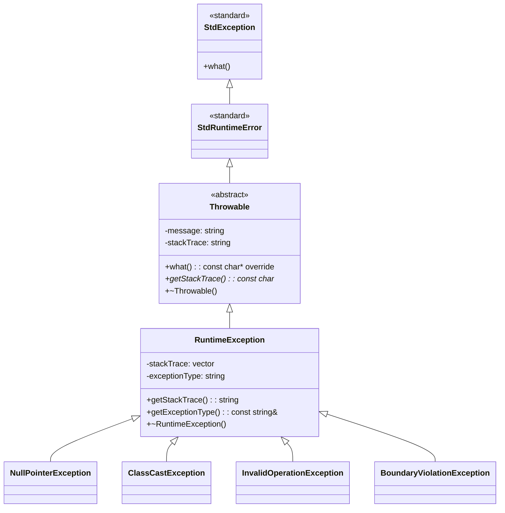
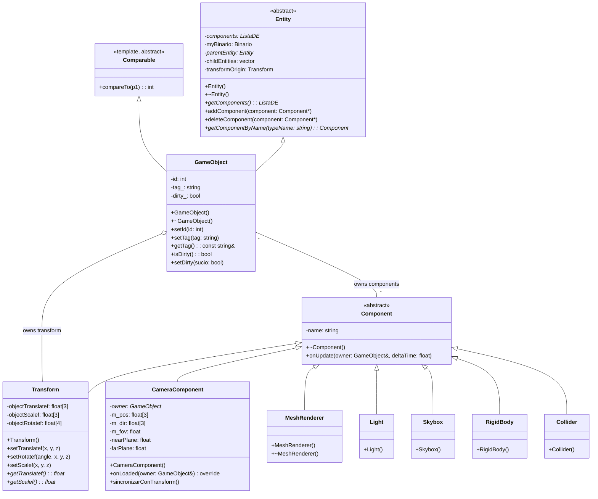
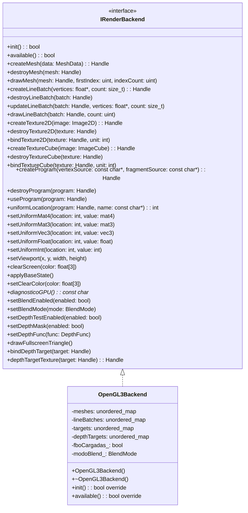
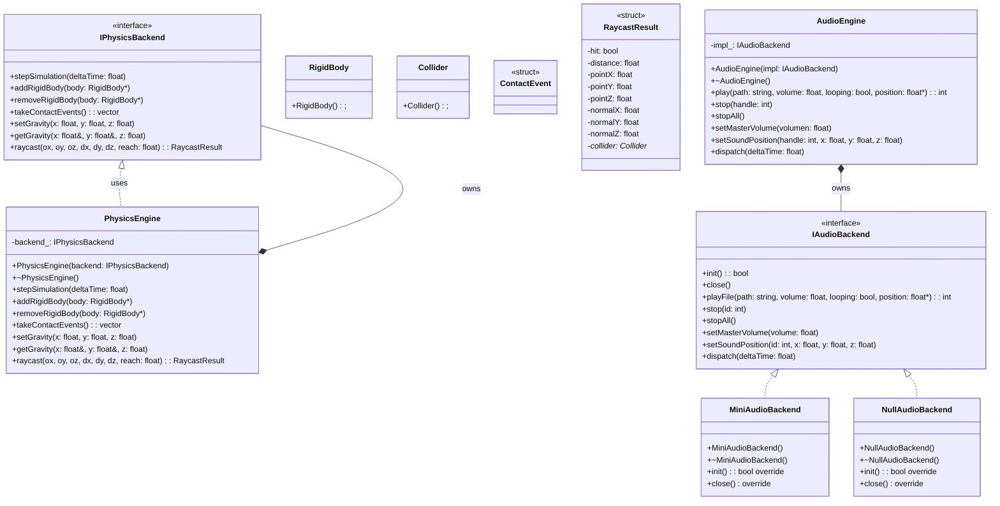
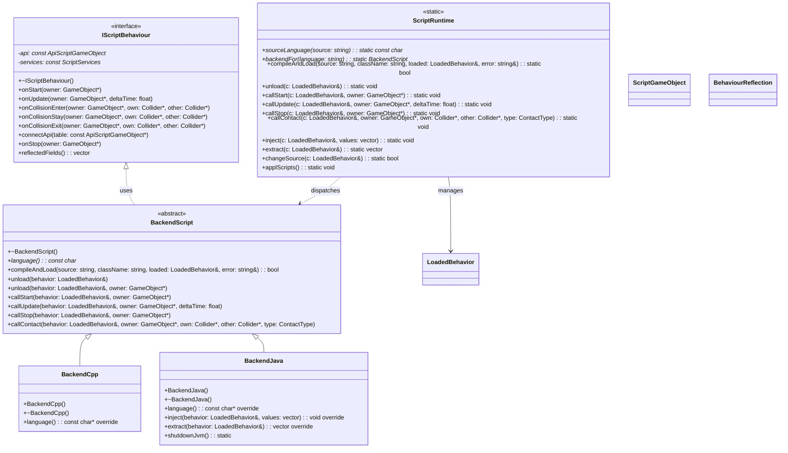
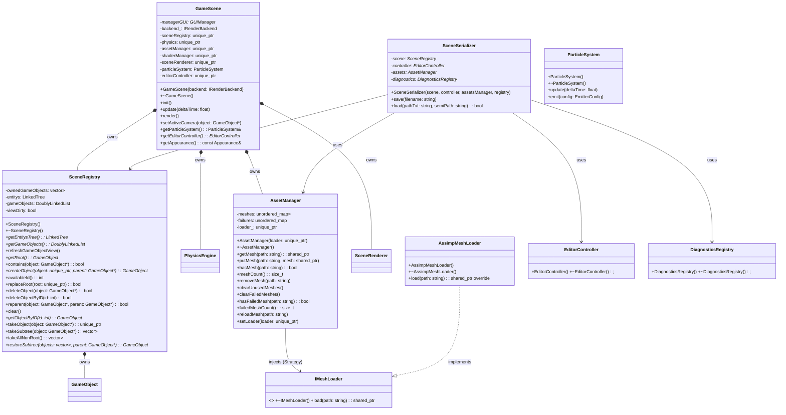
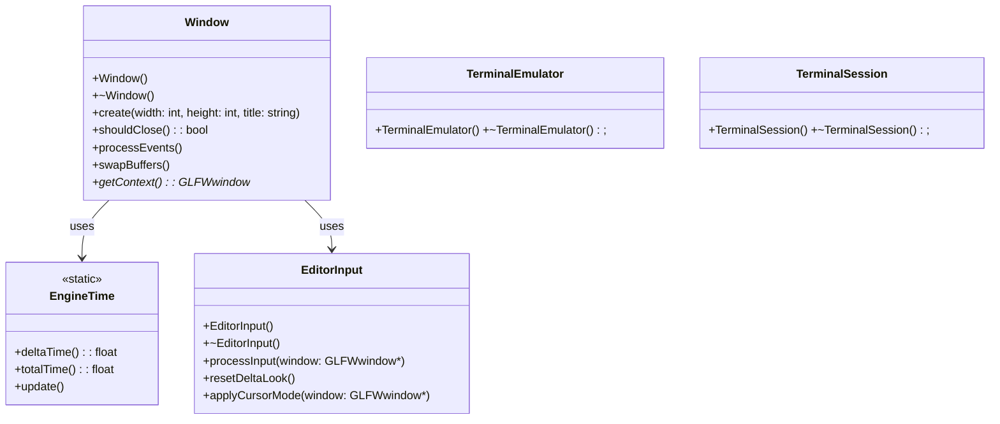
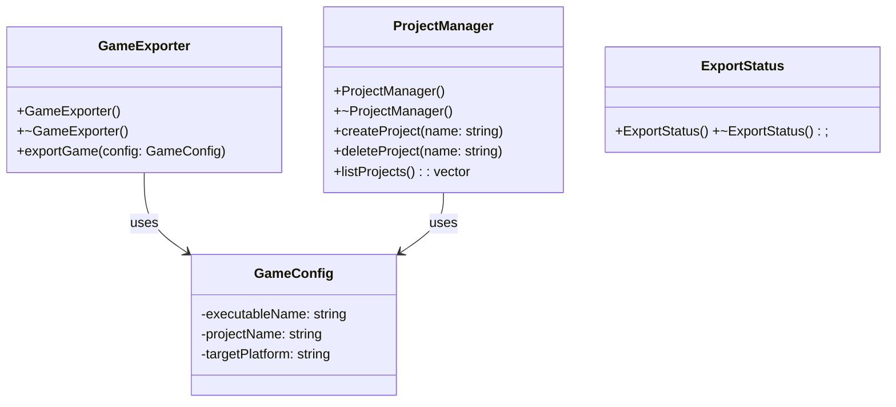

# Class Diagram - FunshiEngineOpenGL

UML Class Diagram for the FunshiEngineGL 3D graphics engine. Generated from source code in `FunshiEngineGL/src/`.

> **Important Mermaid syntax note**: Class names with special characters (`::`, `~`, `<`, `>`, `*`) must be simplified or use the `as "name"` alias for proper rendering on GitHub/GitLab. Simplified names are used here.

Conventions:
- **Types**: PascalCase (`GameObject`, `RenderCommand`)
- **Methods**: camelCase (`initEngine`, `processCommands`)
- **Language**: English (identifiers, comments, documentation)
- **Relationships**: `..|>` inheritance/implementation, `--` association, `*` composition, `o--` aggregation

## 1. Exception Hierarchy



Location: `src/ExceptionsCPP/`

## 2. Entities, Components and Scene Objects



## 3. Rendering (Backend and Pipeline)



Location: `src/Rendering/`

## 4. Physics and Audio



Location: `src/Physics/`, `src/Audio/`

## 5. Scripting and Behaviors



Location: `src/Behaviour/`

## 6. Commands (Undo/Redo)

```mermaid
classDiagram
    class ICommand {
        <<interface>>
        +~ICommand()
        +execute()
        +undo()
        +description(): string
    }
    class CommandManager {
        -commands: vector<unique_ptr<ICommand>>
        -currentIndex: int
        +CommandManager()
        +~CommandManager()
        +executeCommand(command: unique_ptr<ICommand>)
        +undo()
        +redo()
        +canUndo(): bool
        +canRedo(): bool
    }
    class AddComponentCommand { +execute() override +undo() override +description(): string override }
    class RemoveComponentCommand { +execute() override +undo() override +description(): string override }
    class CreateObjectCommand { +execute() override +undo() override +description(): string override }
    class DeleteObjectCommand { +execute() override +undo() override +description(): string override }
    class ReparentCommand { +execute() override +undo() override +description(): string override }
    class TransformCommand { +execute() override +undo() override +description(): string override }
    class SetTagCommand { +execute() override +undo() override +description(): string override }
    class DuplicateObjectCommand { +execute() override +undo() override +description(): string override }
    class ClearSceneCommand { +execute() override +undo() override +description(): string override }
    class AdjustVariableCommand { +execute() override +undo() override +description(): string override }

    ICommand <|.. CommandManager : uses
    ICommand <|-- AddComponentCommand
    ICommand <|-- RemoveComponentCommand
    ICommand <|-- CreateObjectCommand
    ICommand <|-- DeleteObjectCommand
    ICommand <|-- ReparentCommand
    ICommand <|-- TransformCommand
    ICommand <|-- SetTagCommand
    ICommand <|-- DuplicateObjectCommand
    ICommand <|-- ClearSceneCommand
    ICommand <|-- AdjustVariableCommand
```



Location: `src/Commands/`

## 7. Scene, Serialization and Registry



Location: `src/Scenes/`, `src/Assets/`

## 8. GUI and Application States

```mermaid
classDiagram
    class ApplicationStateMachine {
        -state: ApplicationState
        +getState(): ApplicationState
        +is(value: ApplicationState): bool
        +transitionTo(value: ApplicationState)
    }
    class ApplicationState <<enumeration>> {
        MainMenu
        Editing
        Debugging
        Playing
        Exiting
    }
    class GUIOrchestrator {
        -machine: ApplicationStateMachine*
        -pendingCloseRequest: bool
        -pausedSimulation_: bool
        -resetRequest_: bool
        +GUIOrchestrator(machine: ApplicationStateMachine*)
        +handleEscapeKey()
        +startStudy(): bool
        +handleSimulationKey(key: SimulationKey)
        +toggleSimulation()
        +startGame()
        +requestReset()
        +consumeResetRequest(): bool
        +shouldMenuBeVisible(): bool
        +shouldSceneRun(): bool
        +pendingClose(): bool
        +inSimulation(): bool
        +inDebug(): bool
        +inGameMode(): bool
        +pausedSimulation(): bool
        +insideEditor(): bool
        +getState(): ApplicationState
    }
    class GUIManager {
        -fileManager: unique_ptr<FileManager>
        -menuGUI: unique_ptr<MenuGUI>
        -settingsModel: unique_ptr<GameObject>
        -settingsGUI: unique_ptr<SettingsInterface>
        -selectableGUI: unique_ptr<SceneSelectionInterface>
        -menuBarGUI: unique_ptr<SceneMenuBarInterface>
        -treeFilesGUI: unique_ptr<TreeFilesInterface>
        -dockSpaceGUI: unique_ptr<DockSpaceInterface>
        -iconsGUI: unique_ptr<IconsGUI>
        -iconRule: unique_ptr<IconRuleCatalog>
        -iconResolver: unique_ptr<IconCatalog>
        -editor: EditorController*
        -currentFolder: unique_ptr<ContentFolderInterface>
        -statusBarGUI: unique_ptr<StatusBarInterface>
        -terminalGUI: unique_ptr<TerminalInterface>
        -modsPanelsGUI: unique_ptr<ModsPanelsInterface>
        -particleAnimationsGUI: unique_ptr<ParticleAnimationsInterface>
        -editorEvents: EditorEventBus
        -windows_: vector<GeneralUserInterface*>
        +GUIManager(window: GLFWwindow*)
        +~GUIManager()
        +bindScene(scene, editor, events, dimensionProvider)
        +getEditorEventBus(): EditorEventBus*
        +getMenuGUI(): MenuGUI*
        +getSettingsGUI(gameObject: GameObject*): SettingsInterface*
        +getMenuBarGUI(): SceneMenuBarInterface*
        +getSelectableGUI(): SceneSelectionInterface*
        +getDockSpaceGUI(): DockSpaceInterface*
        +registerWindow(ventana: GeneralUserInterface*)
        +restoreWindowStates(states: map<string, bool>)
        +getWindowStates(): map<string, bool>
        +setWindowState(name: string, abierta: bool)
    }
    class MenuGUI { +MenuGUI() +~MenuGUI() +SetMenuActive(active: bool) +ConsultMenu(): bool +updateProjects() }
    class DockSpaceInterface { +DockSpaceInterface() +~DockSpaceInterface(); }
    class SceneSelectionInterface { +SceneSelectionInterface() +~SceneSelectionInterface(); }
    class SceneMenuBarInterface { +SceneMenuBarInterface() +~SceneMenuBarInterface(); }

    GUIOrchestrator --> ApplicationStateMachine : uses
    GUIManager --> MenuGUI : owns
    GUIManager --> DockSpaceInterface : owns
    GUIManager --> SceneSelectionInterface : owns
    GUIManager --> SceneMenuBarInterface : owns
    GUIManager --> GeneralUserInterface : registers windows

    class EditorEventBus {
        -listeners: unordered_map<size_t, Callback>
        -nextToken: size_t
        +subscribe(callback: Callback): size_t
        +unsubscribe(token: size_t)
        +publish(event: SceneEvent)
    }
    class SceneEventType <<enumeration>> {
        ObjectCreated
        ObjectDeleted
        ObjectReparented
        ComponentChanged
        SceneCleared
        ObjectSelected
        ComponentStructureChanged
    }
    class SceneEvent <<struct>> {
        -type: SceneEventType
        -object: GameObject*
        -relatedObject: GameObject*
    }
    class EditorConfig {
        -data_: Data
        -generalPending: bool
        -generalPath: string
        -lastGeneralWrite: time_point
        +EditorConfig()
        +~EditorConfig()
        +load(path: string)
        +save(path: string)
        +saveGeneral(path: string)
        +loadGeneral(path: string)
        +saveProject(name: string, path: string)
        +loadProject(name: string, path: string)
        +requestGeneralSave(path: string)
        +dumpGeneralSave()
        +restore()
        +data(): Data&
    }
    class Data <<struct>> {
        -version: int
        -projectName: string
        -language: string
        -cameraSensitivity: float
        -movementSensitivity: float
        -masterVolume: float
        -camerasWindowOpen: bool
        -gizmoOperation: int
        -gizmoGlobal: bool
        -activeCameraId: int
        -dimension: ProjectDimension
        -windowStates: map<string, bool>
        -motorMods: map<string, bool>
        -projectMods: map<string, bool>
    }
```



## 9. Window, Time and Input



## 10. Exporter and Projects



## 11. Data Structures

```mermaid
classDiagram
    class DoublyLinkedList as "DoublyLinkedList<T>" {
        <<template>>
        -head: Node*
        -tail: Node*
        -size: int
        +DoublyLinkedList()
        +~DoublyLinkedList()
        +isEmpty(): bool
        +first(): Node*
        +last(): Node*
        +next(pos: Node*): Node*
        +getElement(): T
    }
    class LinkedTree as "LinkedTree<T>" {
        <<template>>
        +LinkedTree()
        +~LinkedTree()
    }
    class Node as "Node<T>" {
        <<template>>
        -element: T
        -prev: Node*
        -next: Node*
    }
    class PriorityQueue as "PriorityQueue<T>" {
        <<template>>
        +PriorityQueue()
        +~PriorityQueue()
    }
    class BinaryHeap as "BinaryHeap<T>" {
        <<template>>
        +BinaryHeap()
        +~BinaryHeap()
    }
    class MaxBinaryHeap as "MaxBinaryHeap<T>" { +MaxBinaryHeap() +~MaxBinaryHeap(); }
    class MinBinaryHeap as "MinBinaryHeap<T>" { +MinBinaryHeap() +~MinBinaryHeap(); }
    class BinaryTree as "BinaryTree<T>" {
        <<template>>
        +BinaryTree()
        +~BinaryTree()
    }

    Node <|.. DoublyLinkedList : uses
    MaxBinaryHeap ..|> BinaryHeap
    MinBinaryHeap ..|> BinaryHeap
```

Location: `src/DataStructures/`