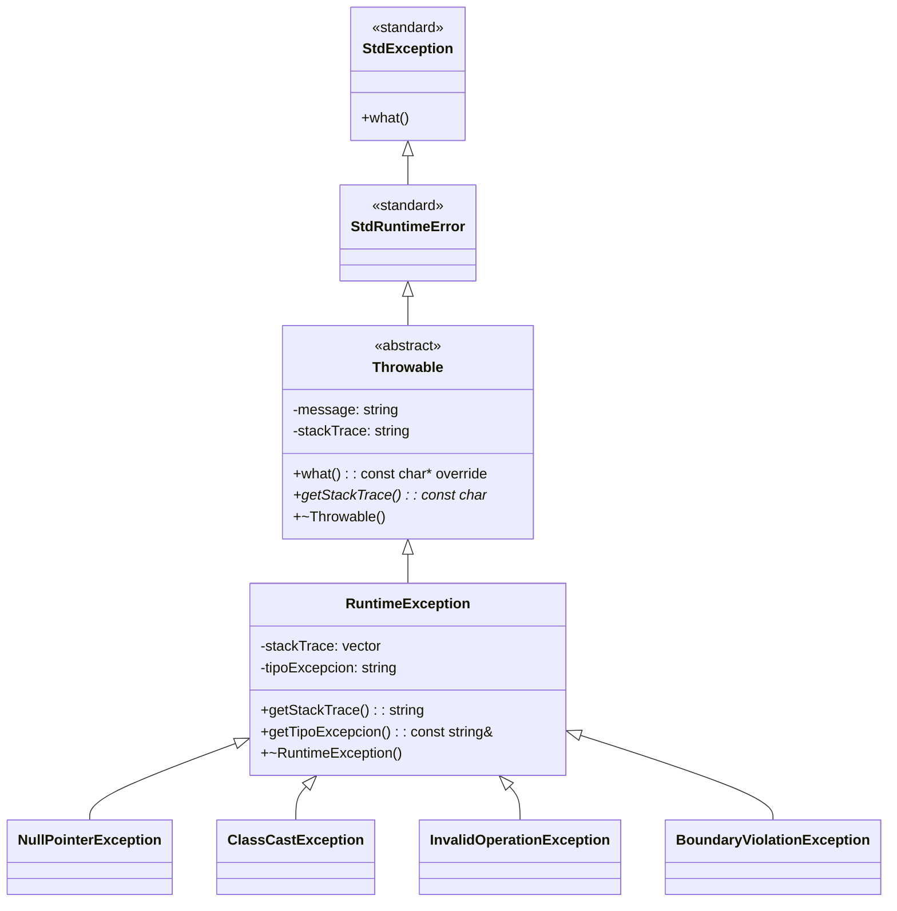
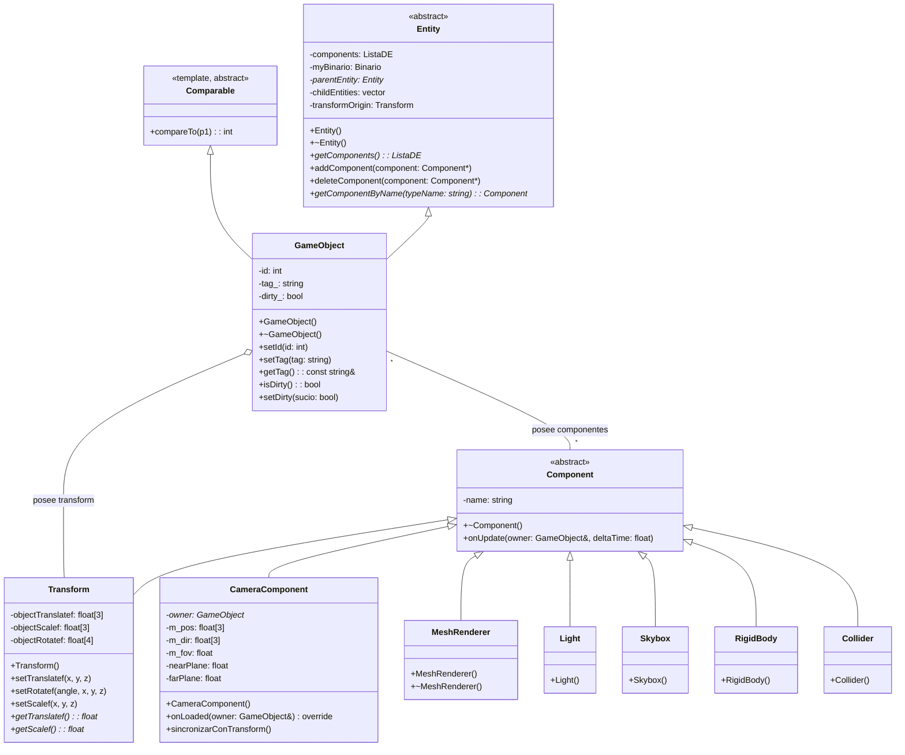
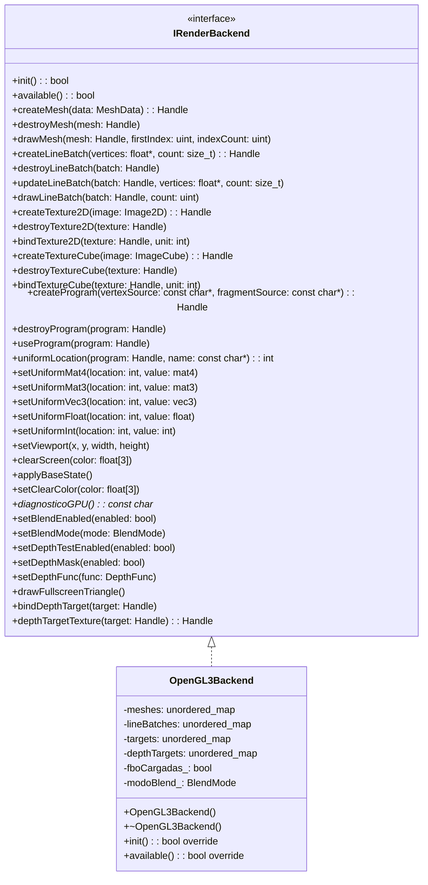
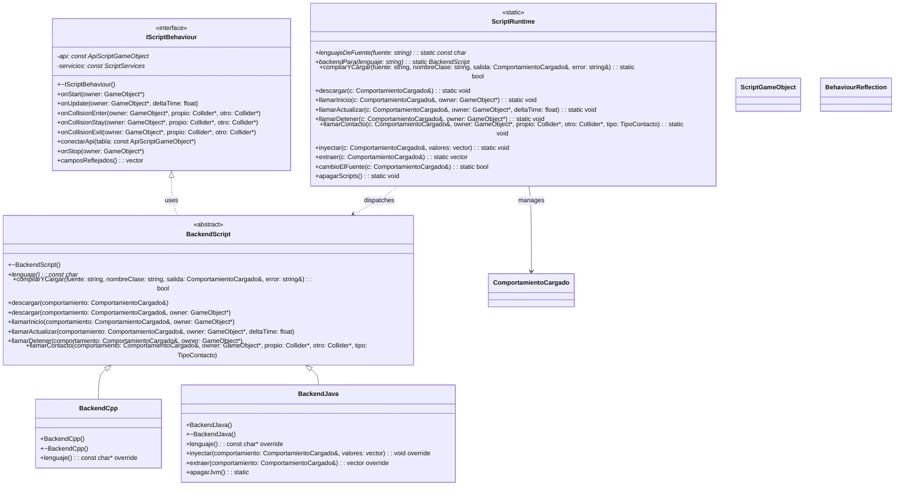
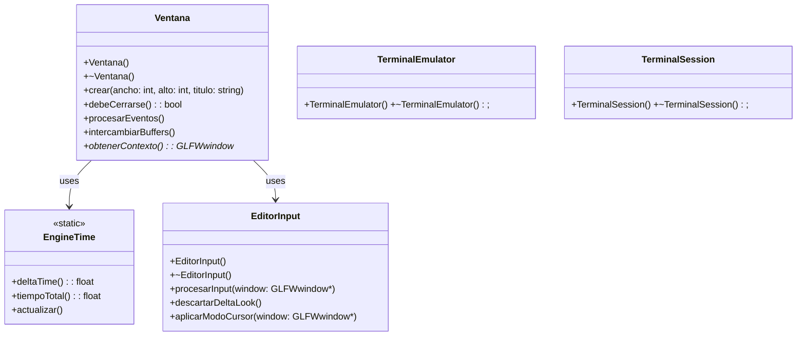
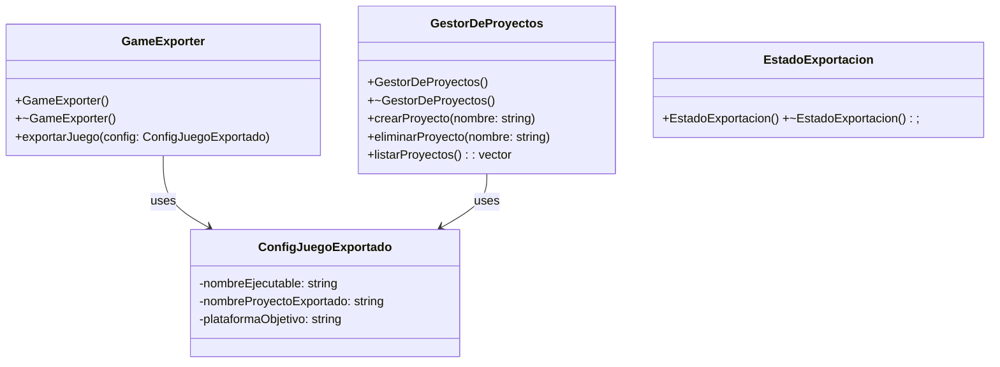

# Diagrama de Clases - FunshiEngineOpenGL

Diagrama UML de clases del motor gráfico 3D FunshiEngineGL. Generado a partir del código fuente en `FunshiEngineGL/src/`.

> **Nota importante de sintaxis Mermaid**: Los nombres de clase con caracteres especiales (`::`, `~`, `<`, `>`, `*`) deben simplificarse o usar el alias `as "nombre"` para que GitHub/GitLab los rendered correctamente. He usado nombres simplificados aquí.

Convenciones:
- **Tipos**: PascalCase (`GameObject`, `RenderCommand`)
- **Métodos**: camelCase (`iniciarMotor`, `procesarComandos`)
- **Idioma**: español (identificadores, comentarios, documentación)
- **Relaciones**: `..|>` herencia / implementación, `--` asociación, `*` composición, `o--` agregación

## 1. Jerarquía de Excepciones



Ubicación: `src/ExcepcionesCPP/`

## 2. Entidades, Componentes y Objetos de Escena



Ubicación: `src/Objetos/`, `src/Objetos/Componentes/`

## 3. Rendering (Backend y Pipeline)



Ubicación: `src/Rendering/`

## 4. Física y Audio

```mermaid
classDiagram
    class IPhysicsBackend {
        <<interface>>
        +stepSimulation(deltaTime: float)
        +addRigidBody(body: RigidBody*)
        +removeRigidBody(body: RigidBody*)
        +tomarEventosContacto(): vector<EventoContacto>
        +fijarGravedad(x: float, y: float, z: float)
        +gravedad(x: float&, y: float&, z: float)
        +raycast(ox, oy, oz, dx, dy, dz, alcance: float): ResultadoRaycast
    }
    class PhysicsEngine {
        -backend_: IPhysicsBackend
        +PhysicsEngine(backend: IPhysicsBackend)
        +~PhysicsEngine()
        +stepSimulation(deltaTime: float)
        +addRigidBody(body: RigidBody*)
        +removeRigidBody(body: RigidBody*)
        +tomarEventosContacto(): vector<EventoContacto>
        +fijarGravedad(x: float, y: float, z: float)
        +gravedad(x: float&, y: float&, z: float)
        +raycast(ox, oy, oz, dx, dy, dz, alcance: float): ResultadoRaycast
    }
    class RigidBody { +RigidBody(); }
    class Collider { +Collider(); }
    struct EventoContacto { }
    struct ResultadoRaycast {
        -impacto: bool
        -distancia: float
        -puntoX: float
        -puntoY: float
        -puntoZ: float
        -normalX: float
        -normalY: float
        -normalZ: float
        -collider: Collider*
    }

    IPhysicsBackend <|.. PhysicsEngine : uses
    PhysicsEngine *-- IPhysicsBackend : owns

    class IAudioBackend {
        <<interface>>
        +iniciar(): bool
        +cerrar()
        +reproducirArchivo(ruta: string, volumen: float, bucle: bool, posicion: float*): int
        +detener(id: int)
        +detenerTodo()
        +setVolumenMaestro(volumen: float)
        +setPosicionSonido(id: int, x: float, y: float, z: float)
        +despachar(deltaTime: float)
    }
    class MiniAudioBackend {
        +MiniAudioBackend()
        +~MiniAudioBackend()
        +iniciar(): bool override
        +cerrar() override
    }
    class NullAudioBackend {
        +NullAudioBackend()
        +~NullAudioBackend()
        +iniciar(): bool override
        +cerrar() override
    }
    class AudioEngine {
        -impl_: IAudioBackend
        +AudioEngine(impl: IAudioBackend)
        +~AudioEngine()
        +reproducir(ruta: string, volumen: float, bucle: bool, posicion: float*): int
        +detener(handle: int)
        +detenerTodo()
        +setVolumenMaestro(volumen: float)
        +setPosicionSonido(handle: int, x: float, y: float, z: float)
        +despachar(deltaTime: float)
    }

    IAudioBackend <|.. MiniAudioBackend
    IAudioBackend <|.. NullAudioBackend
    AudioEngine *-- IAudioBackend : owns
```

Ubicación: `src/Fisicas/`, `src/Audio/`

## 5. Scripting y Comportamientos



Ubicación: `src/Behaviour/`

## 6. Commands (Undo/Redo)

```mermaid
classDiagram
    class IComando {
        <<interface>>
        +~IComando()
        +ejecutar()
        +deshacer()
        +descripcion(): string
    }
    class GestorComandos {
        -comandos: vector<unique_ptr<IComando>>
        -indiceActual: int
        +GestorComandos()
        +~GestorComandos()
        +ejecutarComando(comando: unique_ptr<IComando>)
        +deshacer()
        +rehacer()
        +puedeDeshacer(): bool
        +puedeRehacer(): bool
    }
    class AgregarComponenteComando { +ejecutar() override +deshacer() override +descripcion(): string override }
    class QuitarComponenteComando { +ejecutar() override +deshacer() override +descripcion(): string override }
    class CrearObjetoComando { +ejecutar() override +deshacer() override +descripcion(): string override }
    class BorrarObjetoComando { +ejecutar() override +deshacer() override +descripcion(): string override }
    class ReparentarComando { +ejecutar() override +deshacer() override +descripcion(): string override }
    class TransformComando { +ejecutar() override +deshacer() override +descripcion(): string override }
    class EstablecerTagComando { +ejecutar() override +deshacer() override +descripcion(): string override }
    class DuplicarObjetoComando { +ejecutar() override +deshacer() override +descripcion(): string override }
    class LimpiarEscenaComando { +ejecutar() override +deshacer() override +descripcion(): string override }
    class AjustarVariableComando { +ejecutar() override +deshacer() override +descripcion(): string override }

    IComando <|.. GestorComandos : uses
    IComando <|-- AgregarComponenteComando
    IComando <|-- QuitarComponenteComando
    IComando <|-- CrearObjetoComando
    IComando <|-- BorrarObjetoComando
    IComando <|-- ReparentarComando
    IComando <|-- TransformComando
    IComando <|-- EstablecerTagComando
    IComando <|-- DuplicarObjetoComando
    IComando <|-- LimpiarEscenaComando
    IComando <|-- AjustarVariableComando
```



Ubicación: `src/Comandos/`

## 9. Ventana, Tiempo y Input



## 10. Exportador y Proyectos



## 11. Estructuras de Datos

```mermaid
classDiagram
    class ListaDE<T> {
        <<template>>
        -cabeza: DNodo<T>*
        -cola: DNodo<T>*
        -tamano: int
        +ListaDE()
        +~ListaDE()
        +isEmpty(): bool
        +first(): Position<T>*
        +last(): Position<T>*
        +next(pos: Position<T>*): Position<T>*
        +getElement(): T
    }
    class ArbolEnlazado<T> {
        <<template>>
        +ArbolEnlazado()
        +~ArbolEnlazado()
    }
    class DNodo<T> {
        <<template>>
        -elemento: T
        -anterior: DNodo<T>*
        -siguiente: DNodo<T>*
    }
    class PriorityListaDE<T> {
        <<template>>
        +PriorityListaDE()
        +~PriorityListaDE()
    }
    class Heap<T> {
        <<template>>
        +Heap()
        +~Heap()
    }
    class MaxHeap<T> { +MaxHeap() +~MaxHeap(); }
    class MinHeap<T> { +MinHeap() +~MinHeap(); }
    class ArbolBinarioEnlazado<T> {
        <<template>>
        +ArbolBinarioEnlazado()
        +~ArbolBinarioEnlazado()
    }

    DNodo<T> <|.. ListaDE<T> : uses
    MaxHeap<T> ..|> Heap<T>
    MinHeap<T> ..|> Heap<T>
```

Ubicación: `src/Estructuras/```

Ubicación: `src/States/`, `src/GUIManager/`, `src/Configuracion/`
